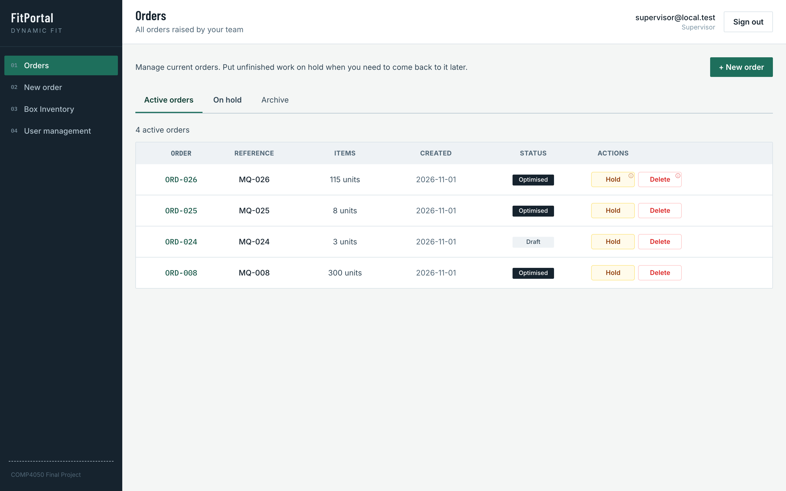
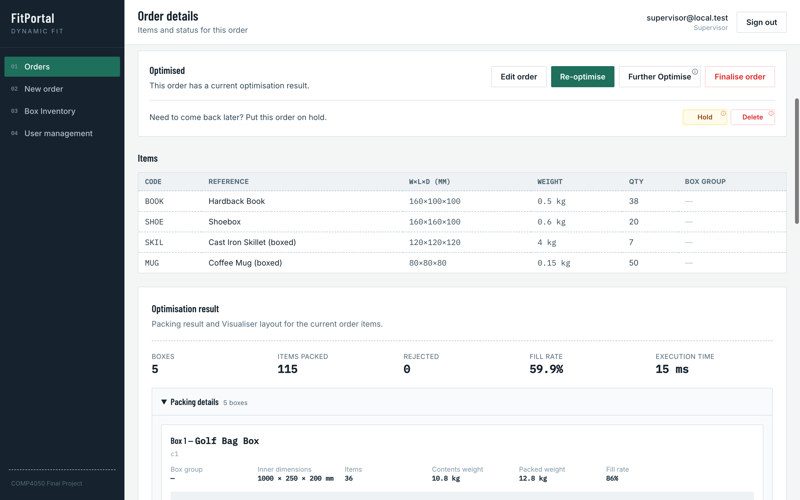
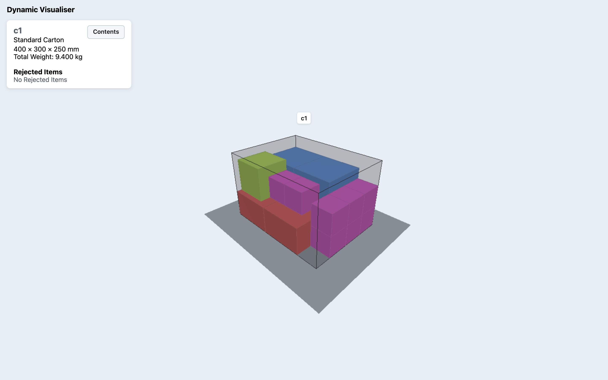

# Dynamic Fit

Dynamic Fit is a system for creating packing orders, optimising how items are packed into boxes, and visualising the result. It brings together FitPortal, FitSolver and FitVisualiser, each built by its own COMP4050 subteam.

> **Live Application:** [Dynamic Fit](https://dynamicfit.aaron-d02.workers.dev/)
>
> **Local Development:** [Getting Started](docs/DEVELOPMENT.md)

## Product Overview

| Name | Role |
|---|---|
| **Dynamic Fit** | The integrated project: Portal, Solver and Visualiser in one application *(this repository)* |
| **FitPortal** | The customer-facing Portal: orders, Box Inventory, users and the API |
| **FitSolver** | The packing engine that chooses the boxes and places every item |
| **FitVisualiser** | The 3D view of each packed box |

Staff create orders in FitPortal. FitSolver works out which boxes to use and where each item goes, and FitVisualiser shows the result in 3D. Finalising an order subtracts the boxes it used from Box Inventory, for box types with a set quantity.

## Subteams

Each subteam develops its part in its own repository, which is then brought into this one. **Detailed documentation for each part lives in that subteam's repository.**

| Subteam | Purpose | Repository |
|---|---|---|
| **FitPortal** | Order management, Box Inventory, user access and the API that connects everything | [AaronMinhas/comp4050-portal](https://github.com/AaronMinhas/comp4050-portal) |
| **FitSolver** | Packing optimisation: choosing boxes and placing items | [Wasif-ZA/DynamicSolver](https://github.com/Wasif-ZA/DynamicSolver) |
| **FitVisualiser** | Interactive 3D visualisation of packing results | [sweetpea004/COMP4050-2026-Dynamic-Visualiser](https://github.com/sweetpea004/COMP4050-2026-Dynamic-Visualiser) |

### FitPortal

| Contributor | Role | GitHub |
|---|---|---|
| Aaron | Scrum Master, Developer | [@AaronMinhas](https://github.com/AaronMinhas) |
| Ahmad | Product Owner, Tester | [@Ahmad-Arja](https://github.com/Ahmad-Arja) |
| Amer | Developer, Tester | [@AmerAlam7](https://github.com/AmerAlam7) |
| Mohammad | Developer, Tester | [@Mohammad123nazimuddin](https://github.com/Mohammad123nazimuddin) |

### FitSolver

| Contributor | Role | GitHub |
|---|---|---|
| Wasif | Project Manager, Scrum Master, Reviewer | [@Wasif-ZA](https://github.com/Wasif-ZA) |
| Jesse | Developer (Algorithm Lead) | [@jesseosu](https://github.com/jesseosu) |
| Khuslee | Developer, Project Board | [@khuslee0409](https://github.com/khuslee0409) |
| Jacob | Developer, Tester | [@JacobLiu124](https://github.com/JacobLiu124) |

### FitVisualiser

| Contributor | Role | GitHub |
|---|---|---|
| Persephone | Product Owner, Developer | [@sweetpea004](https://github.com/sweetpea004) |
| Mohamad | Minute Taker, Developer, Tester | [@Halloum578](https://github.com/Halloum578) |
| Aryan | Scrum Master, Developer | [@aryan-kumar-295](https://github.com/aryan-kumar-295) |
| Sarah | Developer, Tester | [@sar-han](https://github.com/sar-han) |

## How to Use

1. Sign in to FitPortal.
2. Add the warehouse's box types on the Box Inventory page.
3. Create an order and add items by form or JSON import.
4. Run optimisation. FitSolver packs the order into the available boxes.
5. Review the packing result and open the 3D view in FitVisualiser.
6. Finalise the order.
7. The pick packer packs it using FitVisualiser and selects **Done**. FitPortal then shows the order as **Packed**.

## Screenshots



*FitPortal's Orders page, listing active orders with their status and quick actions.*



*An optimised order in FitPortal: 115 items packed into 5 boxes, with nothing rejected.*



*FitVisualiser showing a packed Standard Carton, with each type of item in its own colour.*

## Repository Structure

```text
dynamic-fit/
├── apps/portal/        FitPortal
├── apps/visualiser/    FitVisualiser
├── packages/solver/    FitSolver
├── contract/           The shared format the three parts use to exchange orders and results
├── docs/               Developer guide, client requirements and decision log
└── tests/integration/  Tests that check the three parts work together
```

## Documentation

| Document | Contents |
|---|---|
| [Getting Started](docs/DEVELOPMENT.md) | Running, testing and changing the full project locally |
| [FitPortal](https://github.com/AaronMinhas/comp4050-portal) | Portal features, roles, architecture and API |
| [FitSolver](https://github.com/Wasif-ZA/DynamicSolver) | Packing approach, requirements and benchmarks |
| [FitVisualiser](https://github.com/sweetpea004/COMP4050-2026-Dynamic-Visualiser) | Controls, solution format and testing |
